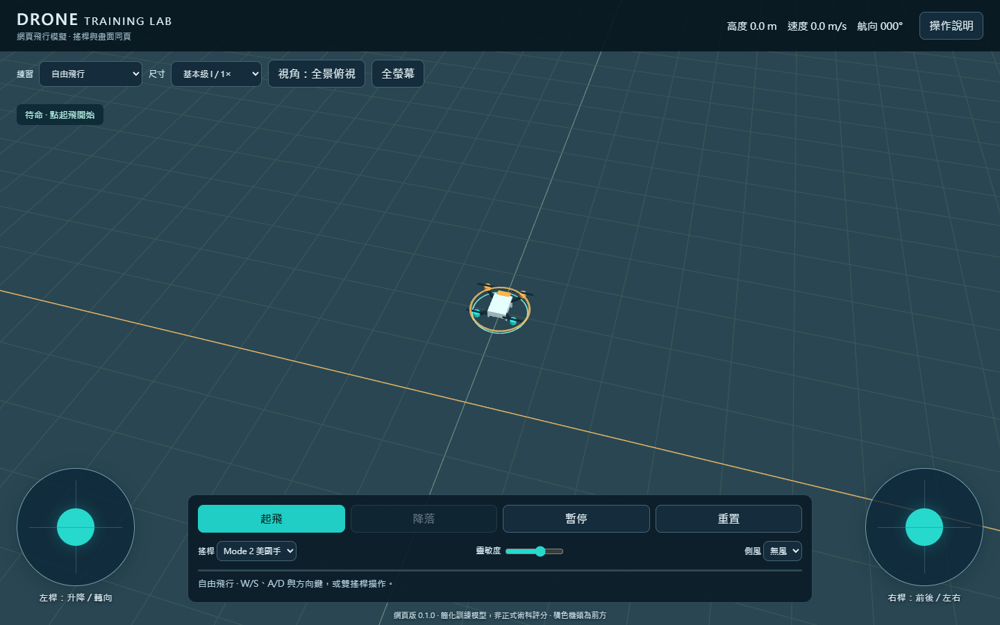

# 無人機飛行訓練 / Unity Drone Simulator

無人機飛行訓練專案，提供 Windows／Android／iOS 的 Unity 模擬器，以及免安裝的網頁線上版本。支援手機直接操作；原生 App 亦可透過同一個 Wi-Fi 當作電腦模擬器的雙搖桿遙控器。

## Hugging Face 線上網頁版

已部署：[開啟 Space](https://huggingface.co/spaces/wangsongwen/drone-training-lab) · [直接開啟飛行畫面](https://wangsongwen-drone-training-lab.static.hf.space/index.html)

網頁原始碼位於 [HuggingFaceSpace](HuggingFaceSpace)，完整操作與部署文件見 [網頁版說明](HuggingFaceSpace/README.md)。不需安裝 App，開啟網址即可在同一頁觀看 3D 飛行畫面並操作雙搖桿。

| 網頁功能 | 內容 |
|---|---|
| 飛行畫面 | 即時 3D 場景、橘色機頭方向標示、高度／速度／航向數據 |
| 操控 | 手機雙指雙搖桿、電腦鍵盤、Mode 1／2／3、靈敏度調整 |
| 飛行操作 | 自動起飛至約 1.5 m、降落、暫停／繼續、重置、側風設定 |
| 視角 | 全景俯視、眼高操作員、跟隨；支援全螢幕 |
| 七種練習 | 自由飛行、四面停懸、12 × 5 m 雙向矩形、8 字水平圓、側面前後飛行、20 m 五邊航線、定點降落 |
| 路線回饋 | 顯示路線、目前目標、高度與航向提示、連續停懸計時及進度 |
| 尺寸選擇 | 基本級 I／II／III 對應 1×／1.5×／2×；矩形固定 12 × 5 m |
| 操作中斷 | 放開搖桿歸零；切換分頁至背景自動暫停；一般失焦只清除控制，需手動繼續 |
| 部署 | Hugging Face Static Space，附所有前端資產與 Three.js，不需 GPU 或後端 |

### 網頁快速操作

1. [直接開啟飛行畫面](https://wangsongwen-drone-training-lab.static.hf.space/index.html)，手機建議橫向使用。
2. 選擇練習與尺寸，再按「起飛」。若顯示「已暫停」，先按「繼續」。
3. 預設 Mode 2：左桿上下升降、左右轉向；右桿上下前後、左右側移。移動方向依機頭朝向決定。
4. 鍵盤 W/S、A/D 控制左桿，方向鍵控制右桿；Space 起飛／降落、P 暫停、C 切換視角、R 重置。
5. 依底部目標提示練習，結束後按「降落」。變更練習或尺寸會重置飛機。

### 下載與自行部署

[下載網頁部署 ZIP](https://github.com/wangsungwen/unity-drone-simulator/releases/download/web-v0.1.0/DroneTrainingLab-Web-v0.1.0-HuggingFace.zip) · [Web 0.1.0 發行頁](https://github.com/wangsungwen/unity-drone-simulator/releases/tag/web-v0.1.0)

在 Hugging Face 建立 **Static** Space，將部署 ZIP 解壓後的內容直接放在 Space 根目錄，保留 README 的 YAML 設定，入口為 `index.html`。詳細步驟見 [部署文件](HuggingFaceSpace/README.md#部署)。

此網頁版為獨立 JavaScript 簡化訓練模型，沒有跨裝置遙控、UDP 配對、Windows 畫面串流或真機飛控，不等同 Unity 完整術科判定。需要支援 WebGL 與 JavaScript modules 的現代瀏覽器；Android 5 舊手機請使用原生 APK。已通過模型及 Chrome 瀏覽器測試，並驗證線上畫面載入與起飛；實體手機與 Safari 尚待驗收。

## 最新版下載

請前往 [v0.2.2 發行頁](https://github.com/wangsungwen/unity-drone-simulator/releases/tag/v0.2.2) 下載：

- `DroneTrainingLab-v0.2.2-Windows.zip`：解壓後執行 Windows/DroneTrainingLab.exe，保留 DLL 與 Data 資料夾。
- `DroneTrainingLab-v0.2.2-Android.zip`：手機單機模擬器及電腦遙控器兩個 APK，支援 Android 5.1.1 以上（最低 API 22），含 ARMv7／ARM64。
- `DroneTrainingLab-v0.2.2-iOS-Xcode.zip`：兩種 App 的完整 Xcode 匯出專案；須在 Mac 設定 Apple Team、編譯及簽署。此檔不是可直接安裝的 IPA。
- `DroneLegacyRemote-v1.0.0-Android5.zip`：另附 Android 5.0 原生輕量遙控器。
- `Source code (zip)`：GitHub 提供此次版本的原始碼，包含 Unity 專案、原生 Android 遙控器、建置工具及文件。

## 開發位置與 Android 相容性（v0.2.2）

本機後續更新以 `D:\ResearchCodes\Mavic2Autonomy` 為主，Unity 專案位於其下 `unity-drone-simulator`；版本化舊資料夾保留作歷史備份。

Android 兩種 App 的最低版本調整為 **Android 5.1 / API 22**，同時包含 **ARMv7（需 NEON）與 ARM64**，使用 OpenGL ES 3.0／2.0。Android 5.0 / API 21 不在 Unity 2022.3 的支援範圍；可使用另製的 [Android 5.0 原生輕量遙控器](AndroidLegacyRemote/README.md) 控制電腦畫面。最低安裝版本與 target SDK 不同，target SDK 保持 34。

本次 Android 相容性更新可用 `python tools/package-platforms.py --platform Android` 單獨打包；Windows 與 iOS Xcode 匯出亦已更新至 v0.2.2。舊手機的安裝、雙指操控、3D 效能及 Wi-Fi 配對仍需實機驗收。詳見 [Android 舊手機安裝說明](docs/Android舊手機相容性.md)。

## Unity App 功能

- 手機雙指雙搖桿，支援 Mode 1／2／3、靈敏度調整。
- 起飛、降落、重置、定位／姿態練習及風速設定。
- 參照 AC 107-005D：四面停懸、雙向矩形、8 字水平圓、側面前後飛行、五邊航線及緊急返航。
- 基本級未達 2 kg 與基本級 I／II／III 選單、飛行前後及口述程序複習。
- 預設全景俯視、自動容納完整航線；可切換 1.7 m 眼高操作員、跟隨與機頭视角。
- 數據固定於頂端，任務提示固定於底部，中央保留飛行場域。
- Wi-Fi 配對、即時遙測與 0.6 秒連線逾時控制歸零。
- Windows、Android、iOS 共用 Unity 原始碼與建置工具。

## 兩種手機 App（v0.2.1）

| App | 用途 | Android 檔案 |
|---|---|---|
| 無人機飛行模擬器 | 雙搖桿直接控制手機上的 3D 飛行場景，不需連線 | `Builds/Android/DroneTrainingLab.apk` |
| 無人機電腦遙控器 | 手機顯示搖桿，控制同 Wi-Fi 電腦的飛行場景 | `Builds/AndroidRemote/DroneRemoteController.apk` |

兩個 App 使用不同識別碼，可以同時安裝。Windows 選「電腦畫面接收端」並啟動接收；手機遙控器填入 IPv4 與六位碼。App 內也可用上方模式按鈕切換，啟動預設依安裝版本決定。

iOS 對應匯出 `Builds/iOS` 與 `Builds/iOSRemote` 兩份 Xcode 專案，需在 Mac 編譯及簽署。三平台壓縮檔可用 `python tools/package-platforms.py` 產生；Android ZIP 內含兩個 APK，iOS ZIP 內含兩份專案。

## 開始使用

1. 使用 Unity Hub 安裝 **Unity 2022.3.62f2** 與所需平台模組。
2. Clone 本儲存庫，在 Unity Hub 開啟儲存庫根目錄。
3. 開啟 `Assets/DroneTrainer/Scenes/Trainer.unity`，按 Play。
4. 選「手機／單機飛行」→「起飛」，開始操作。
5. 需要建置時，使用 **Drone Trainer → Build** 選單。

手機遙控電腦：電腦選「電腦接收手機」→「啟動接收」；手機選「手機遙控器」，輸入電腦 IPv4 與六位配對碼。兩端需在同一區域網路，電腦允許 UDP 47777。

本儲存庫包含原始碼、Unity 資產、設定、文件及測試；`Builds`、`Library`、本機工具與快取不納入 Git。可從發行頁下載 APK／Windows 執行檔；iOS 安裝需 Mac／Xcode 編譯及簽署。

## 文件與驗證

- [術科項目、來源與模擬容差](docs/術科項目對照.md)
- [完整繁體中文操作與建置說明](README_繁體中文.md)
- [架構與連線協定](docs/架構與協定.md)
- [驗證紀錄與實機驗收](docs/驗證紀錄.md)
- [Unity 整合測試結果](docs/play-smoke-results.txt)

v0.2.1 的測試與建置狀態見驗證紀錄。手機實機與跨裝置 Wi-Fi 尚待驗收。測驗項目參照官方規範，數值容差為訓練設定；本程式控制虛擬飛機，不包含真機飛控。

中文字型使用 Noto Sans CJK TC，授權見 [SIL OFL 1.1](Assets/DroneTrainer/Resources/FONT-LICENSE.txt)。
