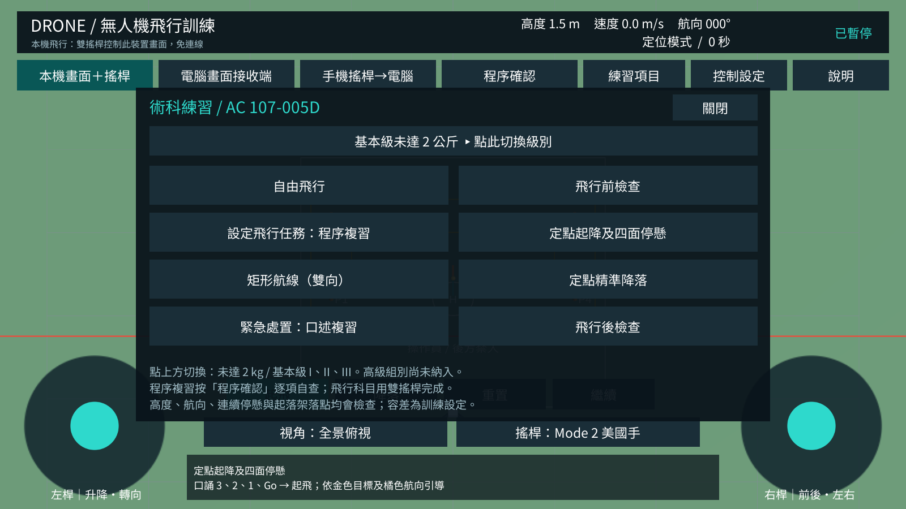

# 無人機飛行訓練 / Unity Drone Simulator

Unity 3D 無人機模擬器，支援手機直接操作，以及手機透過同一個 Wi-Fi 當作電腦模擬器的雙搖桿遙控器。

## 功能

- 手機雙指雙搖桿，支援 Mode 1／2／3、靈敏度調整。
- 起飛、降落、重置、定位／姿態練習及風速設定。
- 參照 AC 107-005D：四面停懸、雙向矩形、8 字水平圓、側面前後飛行、五邊航線及緊急返航。
- 基本級未達 2 kg 與基本級 I／II／III 選單、飛行前後及口述程序複習。
- 預設全景俯視、自動容納完整航線；可切換 1.7 m 眼高操作員、跟隨與機頭视角。
- 數據固定於頂端，任務提示固定於底部，中央保留飛行場域。
- Wi-Fi 配對、即時遙測與 0.6 秒連線逾時控制歸零。
- Windows、Android、iOS 共用 Unity 原始碼與建置工具。

## 兩種手機 App（v0.2.1）

| App | 用途 | Android 檔案 |
|---|---|---|
| 無人機飛行模擬器 | 雙搖桿直接控制手機上的 3D 飛行場景，不需連線 | `Builds/Android/DroneTrainingLab.apk` |
| 無人機電腦遙控器 | 手機顯示搖桿，控制同 Wi-Fi 電腦的飛行場景 | `Builds/AndroidRemote/DroneRemoteController.apk` |

兩個 App 使用不同識別碼，可以同時安裝。Windows 選「電腦畫面接收端」並啟動接收；手機遙控器填入 IPv4 與六位碼。App 內也可用上方模式按鈕切換，啟動預設依安裝版本決定。

iOS 對應匯出 `Builds/iOS` 與 `Builds/iOSRemote` 兩份 Xcode 專案，需在 Mac 編譯及簽署。三平台壓縮檔可用 `python tools/package-platforms.py` 產生；Android ZIP 內含兩個 APK，iOS ZIP 內含兩份專案。

## 開始使用

1. 使用 Unity Hub 安裝 **Unity 2022.3.62f2** 與所需平台模組。
2. Clone 本儲存庫，在 Unity Hub 開啟儲存庫根目錄。
3. 開啟 `Assets/DroneTrainer/Scenes/Trainer.unity`，按 Play。
4. 選「手機／單機飛行」→「起飛」，開始操作。
5. 需要建置時，使用 **Drone Trainer → Build** 選單。

手機遙控電腦：電腦選「電腦接收手機」→「啟動接收」；手機選「手機遙控器」，輸入電腦 IPv4 與六位配對碼。兩端需在同一區域網路，電腦允許 UDP 47777。

本儲存庫包含原始碼、Unity 資產、設定、文件及測試；`Builds`、`Library`、本機工具與快取不納入 Git。請自行建置 APK／Windows 執行檔；iOS 安裝需 Mac／Xcode 編譯及簽署。

## 文件與驗證

- [術科項目、來源與模擬容差](docs/術科項目對照.md)
- [完整繁體中文操作與建置說明](README_繁體中文.md)
- [架構與連線協定](docs/架構與協定.md)
- [驗證紀錄與實機驗收](docs/驗證紀錄.md)
- [Unity 整合測試結果](docs/play-smoke-results.txt)

v0.2.1 的測試與建置狀態見驗證紀錄。手機實機與跨裝置 Wi-Fi 尚待驗收。測驗項目參照官方規範，數值容差為訓練設定；本程式控制虛擬飛機，不包含真機飛控。

中文字型使用 Noto Sans CJK TC，授權見 [SIL OFL 1.1](Assets/DroneTrainer/Resources/FONT-LICENSE.txt)。
