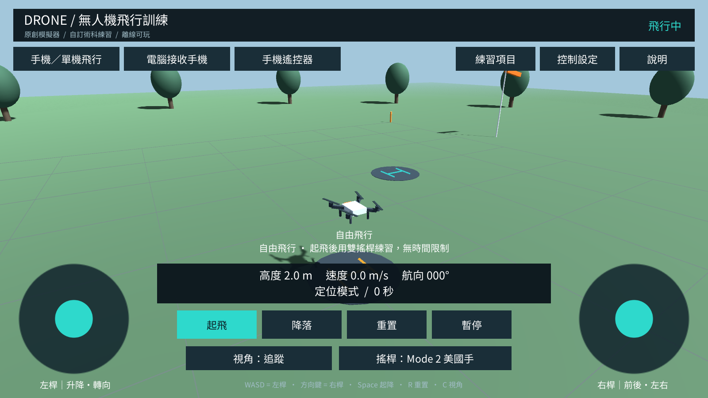

> v0.2.1 更新：數據移至頂端、提示移至下緣；新增預設全景俯視與眼高操作員視角；手機提供獨立「飛行模擬器」及「電腦遙控器」App。兩個 App 可同時安裝，詳細對照見 [README](README.md)。

## 網頁線上版（Web 0.1.0）

- [直接開啟飛行畫面](https://wangsongwen-drone-training-lab.static.hf.space/index.html) · [Hugging Face Space](https://huggingface.co/spaces/wangsongwen/drone-training-lab)
- 提供 3D 畫面與雙搖桿同頁、鍵盤控制、Mode 1／2／3、三種視角、七種練習及側風／靈敏度設定。
- [功能清單與快速操作](README.md#hugging-face-線上網頁版) · [網頁原始碼及部署說明](HuggingFaceSpace/README.md) · [部署包下載](https://github.com/wangsungwen/unity-drone-simulator/releases/tag/web-v0.1.0)
- 網頁版採獨立簡化模型，不包含跨裝置遙控或 Windows 畫面串流；完整術科功能請使用下方 Unity App。


# 無人機飛行訓練 Unity 專案

原創的 Unity 3D 無人機練習專案，支援 **手機直接玩** 與 **手機當 Wi-Fi 遙控器、電腦顯示模擬場景**。同一份 Unity 原始碼可建置 Windows、Android 與 iOS。專案獨立於母目錄的 DJI／Android 程式，沒有真機飛控介面。

**初版交付紀錄（v0.1.0；v0.2.0 更新見驗證紀錄）：**已使用 Unity 2022.3.62f2 完成完整編譯、Windows EXE 與 Android ARM64 APK 建置，35 項核心 C# 斷言及 15 項 Unity 整合檢查通過。Windows 執行檔另通過啟動檢查；已有實際 Unity 渲染截圖。Android／iOS 實機觸控及跨裝置 Wi-Fi 尚待驗收，沒有預先簽署的 IPA。詳細狀態見 [驗證紀錄](docs/驗證紀錄.md)。

已建置檔案：`Builds/Windows/DroneTrainingLab.exe`、`Builds/Android/DroneTrainingLab.apk`、`Builds/iOS/Unity-iPhone.xcodeproj`。iOS 已成功匯出並驗證區域網路用途說明，但尚未在 Xcode 原生編譯／簽署。可先在 Android 安裝 APK；電腦執行 Windows 版，依下方「手機控制電腦」步驟配對。



其他實際介面：[手機搖桿→電腦](docs/screenshots/phone-remote.png)、[電腦接收模式](docs/screenshots/desktop-host.png)。

## 快速開始

1. 在 Unity Hub 安裝 **Unity 2022.3.62f2**，勾選要使用的建置模組。Android 需 Android Build Support、SDK/NDK、OpenJDK；iOS 需 iOS Build Support，後續簽署與安裝需 macOS 的 Xcode。
2. Hub → Add project from disk → 選本資料夾 `unity-drone-simulator`，不要選外面的 Android 專案。
3. 首次匯入會執行 `TrainerBuild.Configure()`，設定橫向、套件名稱、Android 網路權限、場景清單及材質。第一次需讓 Package Manager 取得 Unity UGUI 相依套件。
4. 選單 **Drone Trainer → 2. Open training scene**，或開啟 `Assets/DroneTrainer/Scenes/Trainer.unity`，按 Play。
5. 選「本機畫面＋搖桿」→「起飛」。3D 場景與 UI 在 Play 時由程式產生，編輯模式的 Hierarchy 只有啟動物件是正常的。

不需要 Asset Store 素材、帳號服務或 DJI App Key。中文字型已附於 Resources，離線執行不需下載資源。

## 已實作功能

| 項目 | 內容 |
|---|---|
| 飛行控制 | Rigidbody 速度控制、平滑加減速、升降、偏航、前後、左右、起飛、降落、重置 |
| 觸控遙控器 | 左右獨立 pointer ID，支援同時兩指操作，放手回中、背景清除輸入 |
| 搖桿配置 | Mode 2、Mode 1、Mode 3，操控／升降靈敏度與 8% deadzone |
| 飛行模式 | 定高搭配定位模式；姿態練習模式保留風造成的水平漂移 |
| 視角 | 追蹤、地面操作員、機頭視角 |
| 場景 | 原創四軸模型、5 公尺格線、起降區、目標路線、邊界柱、機庫與樹木 |
| 練習 | 自由飛行、四面停懸、雙向矩形、8 字、側面前後、五邊、緊急返航與程序複習 |
| 環境 | 0–6 m/s 設定風速、45° 風向切換、簡化陣風 |
| 手機連線 | UDP 30 Hz 控制、10 Hz 遙測、六位配對码、單一手機控制權 |
| 連線保護 | Session／序號檢查、0.6 秒 watchdog、斷線歸零、重新配對 |
| 建置 | Unity 選單與 PowerShell 批次建置 Windows、Android APK、iOS Xcode 專案 |

這是以公開功能為參考的重新實作，並非原 App 的原始碼、畫面或素材複本。尚未涵蓋原 App 的藍牙實體搖桿、所有考科流程或逐項相同的物理手感。

## 手機直接模擬飛行

Android 安裝自行建置的 APK；iPhone/iPad 安裝自行簽署的 iOS App。進入「本機畫面＋搖桿」，按「起飛」會先自動升到約 2 公尺，之後自行操控。往橘色機頭方向為「前」。

| 配置 | 左桿上下 | 左桿左右 | 右桿上下 | 右桿左右 |
|---|---|---|---|---|
| Mode 2 美國手（預設） | 升降 | 轉向 | 前後 | 左右 |
| Mode 1 日本手 | 前後 | 轉向 | 升降 | 左右 |
| Mode 3 中國手 | 前後 | 左右 | 升降 | 轉向 |

油門採回中定高的速度控制概念；不是完全手動馬達油門或 Acro 飛控。最大水平命令 5 m/s、升降 2.5 m/s、偏航 85°/s，再乘上使用者靈敏度。此為簡化訓練模型，未做機型實測校準。

電腦鍵盤：W/A/S/D 對應左桿，方向鍵對應右桿；Space 起飛／降落，R 重置，C 切換視角。輸入 IP／配對碼時不會把鍵盤輸入當飛行操作。

## 手機控制電腦

1. 電腦與手機連上同一個 Wi-Fi／區域網路；避免訪客網路的裝置隔離。
2. 電腦執行 Windows 版或 Unity Play，選「電腦畫面接收端」→「啟動接收」。
3. 畫面列出電腦 IPv4 與六位配對碼；有多個 IP 時選 Wi-Fi 網卡的位址，可用 `ipconfig` 核對。
4. 手機選「手機搖桿→電腦」，輸入電腦 IPv4 與當次配對碼，按「連線」。
5. 看到已連線及遙測後，手機按「起飛」，用雙搖桿操作。練習項目、風與場景視角在電腦設定。
6. 電腦防火牆若提示連線權限，允許此程式使用私人網路。協定為 **UDP 47777**，不是 TCP；Unity Editor 與 EXE 不可同時占用接收埠。
7. iOS 若出現區域網路權限提示請允許；授權對話框可能使 App 暫停，回到 App 後重新啟動接收並配對即可。

手機遙控模式只顯示控制介面及高度、速度、航向、練習提示，沒有從電腦串流 3D 視訊。電腦端維持背景執行，以便 Unity 視窗失焦時仍能接受手機。

手機進背景、中斷連線或超過 0.6 秒收不到有效新封包後，模擬飛機清除輸入並停止當前速度。兩端都需重新配對，不會以舊封包自動恢復。斷線後風與姿態模式仍由模擬器持續計算，姿態模式可能繼續受風漂移。配對码與 token 不是加密通道，只適用受信任區域網路。

## 練習規則

按「練習項目」開啟科目選單，上方可切換「基本級未達 2 公斤」及「基本級 I／II／III」。每次選科目會重置飛機。金色球表示當前目標，橘色短線表示機頭方向，青色線表示航線。

四面停懸改為 1–2 m、依順時針轉向且各停懸 5 秒；未達 2 kg 改為 12×5 m 雙向矩形；基本級提供連續 8 字、側面前後飛行、20 m 高五邊航線與較近側八字內圈緊急返航。落地需四個起落架角點均在指定圈內。

程序複習卡按「程序確認」逐項推進；Wi-Fi 遙控器也能傳送確認指令。卡片為自我複習，不自動評定口試答案或實體檢查。詳細項目、來源頁碼、場地尺寸及訓練容差見 [術科項目對照](docs/術科項目對照.md)。沒有固定超時限制；顯示耗時、偏差時間及流程完成狀態，不宣稱正式測驗合格。

## 建置

在 Unity 選單 **Drone Trainer → Build** 選 Windows、Android APK 或 iOS Xcode project。Build 會重新套用預設專案設定；要客製套件名、版本與簽署，請修改 `TrainerBuild.Configure()`。

PowerShell 7 範例：

```powershell
.\tools\build.ps1 -Unity 'C:\Program Files\Unity\Hub\Editor\2022.3.62f2\Editor\Unity.exe' -Target Windows
.\tools\build.ps1 -Unity 'C:\Program Files\Unity\Hub\Editor\2022.3.62f2\Editor\Unity.exe' -Target Android
```

輸出分別在 `Builds/Windows/DroneTrainingLab.exe` 與 `Builds/Android/DroneTrainingLab.apk`。Windows 版需連同其 `_Data` 與 DLL 一起分享，不要只複製 EXE。Android v0.2.2 使用 ARMv7（NEON）與 ARM64、最低 API 22（Android 5.1）、目標 API 34；Android 5.0 不支援，預設開發測試簽署，不是已上架商店的發行檔。

iOS 選單輸出 `Builds/iOS` Xcode 專案，已加入 `NSLocalNetworkUsageDescription`；在 Mac 用 Xcode 選 Apple 開發者團隊與簽署後安裝。沒有附 Apple 憑證，也沒有預建 IPA。UDP 桌面接收不支援 WebGL。

## 測試與文件

```powershell
.\tools\test-core.ps1
```

此腳本需要 PowerShell 7，執行真實 C# 核心邏輯，並用 Roslyn 解析 C# 語法。它不會驗證 Unity API 綁定或渲染；本次另以真正 Unity Editor 完成編譯與整合測試。

Unity 內選 **Drone Trainer → Tests → Play smoke**，約 25 秒，驗證場景啟動、雙指搖桿、UDP loopback 配對、遠端起飛、遙測、前進、回中、偏航、斷線與降落，報告輸出 `TestResults/play-smoke.txt`。此測試本次已執行並通過，副本見 [整合測試結果](docs/play-smoke-results.txt)。

`tools/smoke-player.ps1` 會以無畫面方式啟動已建置的 Windows 版、檢查初始化與例外日誌，再結束該測試程序。畫面截圖由 Unity 真實相機及 UGUI 渲染，保存在 `docs/screenshots`。

本工作區的編輯器安裝在 `../.build_artifacts/unity-tools/2022.3.62f2/Editor/Unity.exe`，可將其傳入 `build.ps1 -Unity`。本機獨立 Android SDK/NDK 亦在同一工具目錄；如不用 Unity Hub 隨附工具，可透過 `DRONE_ANDROID_SDK`、`DRONE_ANDROID_NDK`、`DRONE_ANDROID_JDK` 環境變數指定。工具目錄不包含在原始碼壓縮檔中。

詳見 [架構與連線協定](docs/架構與協定.md)、[驗證紀錄與實機驗收](docs/驗證紀錄.md)。

## 來源與授權

- 功能參考：[台灣無人機術科考試模擬器 App Store 頁面](https://apps.apple.com/tw/app/id1614042036)。僅參考其公開說明，沒有取得或使用其私有原始碼與素材。
- 目標編輯器：[Unity 2022.3.62f2](https://unity.com/releases/editor/whats-new/2022.3.62f2)。
- 中文字型：[Noto Sans CJK TC](https://github.com/notofonts/noto-cjk)，採 SIL OFL 1.1，原授權檔位於 `Assets/DroneTrainer/Resources/FONT-LICENSE.txt`。
- iOS 區域網路說明：[Apple NSLocalNetworkUsageDescription](https://developer.apple.com/documentation/BundleResources/Information-Property-List/NSLocalNetworkUsageDescription)。
